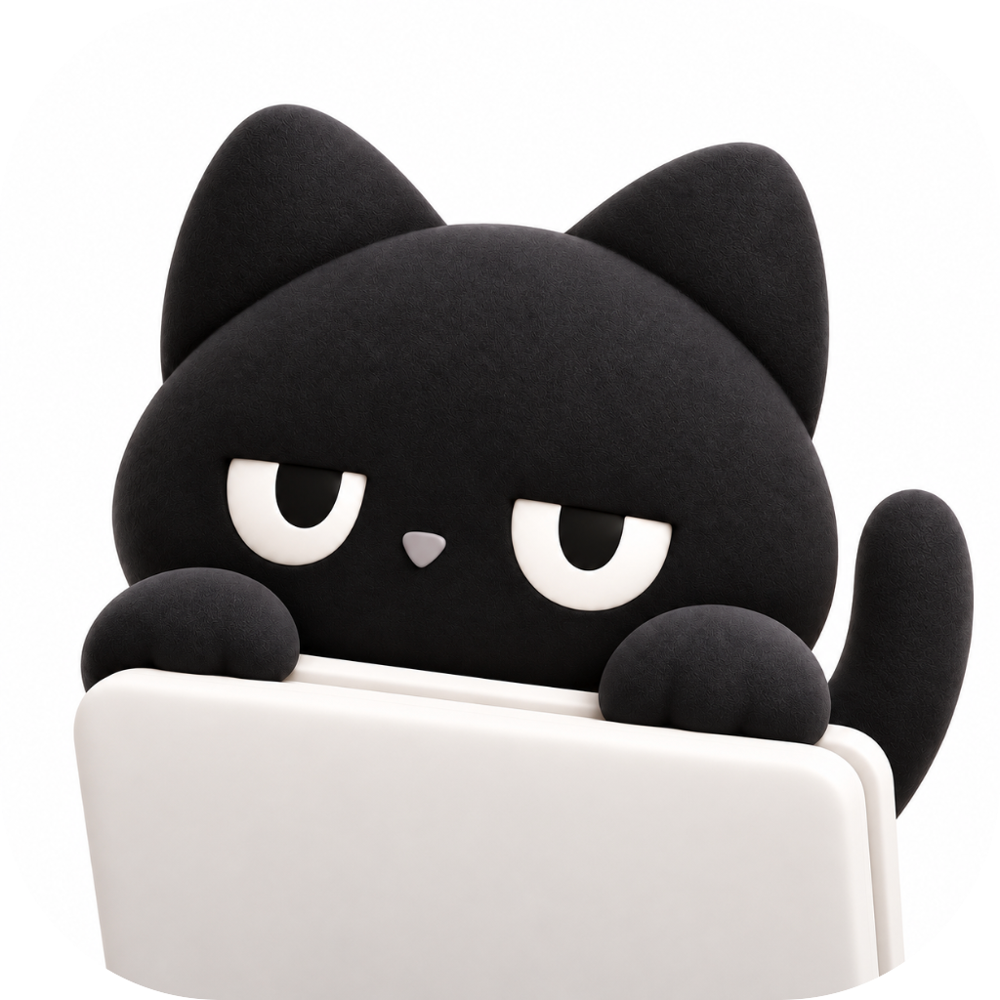
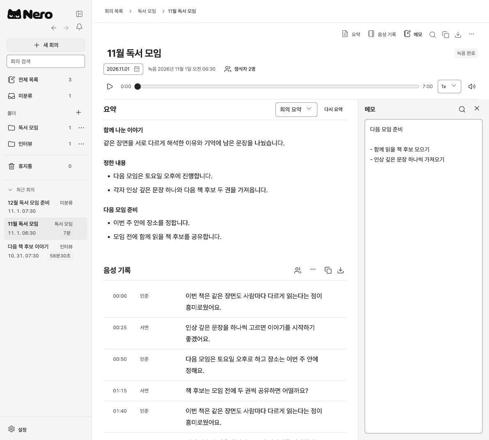
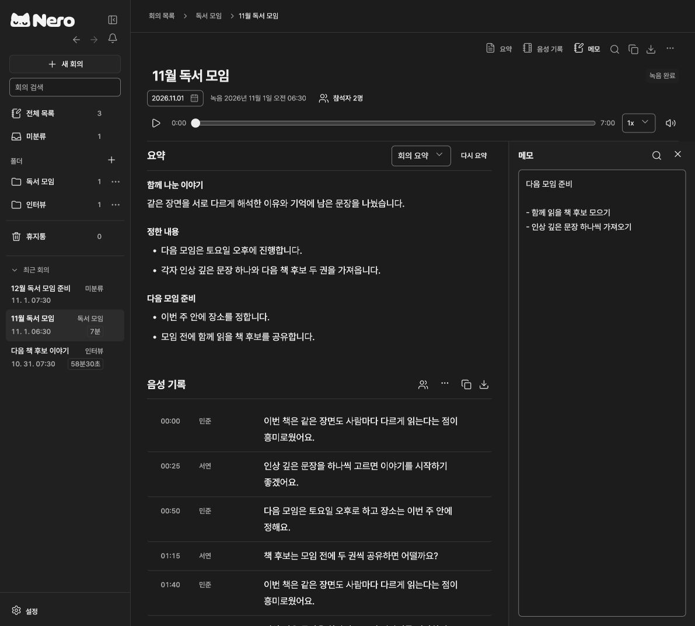

  

  <picture>
    <source media="(prefers-color-scheme: dark)" srcset="apps/desktop/brand/logo/nero-logo-dark.svg">
    
  </picture>

<strong>회의는 기록하고, 정리는 Nero에게.</strong>

내 컴퓨터에서 녹음하고, 글로 읽고, 회의록으로 정리하는 데스크톱 앱입니다.

  <a href="https://github.com/ChoSeongmin1128/Nero/releases">다운로드</a> /
  <a href="#처음-시작하기">처음 시작하기</a> /
  <a href="docs/README.md">사용 안내</a> /
  <a href="https://github.com/ChoSeongmin1128/Nero/issues">문제 제보</a>

## 회의가 끝난 뒤에도 맥락이 남도록

요약과 음성 기록을 한 화면에서 읽고, 필요한 부분은 시간을 눌러 다시 들으세요. 옆에 메모를 열어 함께 정리할 수 있습니다.

| 라이트 | 다크 |
| :---: | :---: |
|  |  |

화면은 실제 앱 UI에 예시 데이터를 표시한 모습입니다. 이미지를 누르면 크게 볼 수 있습니다.

## Nero로 할 수 있는 일

| 기능 | 이렇게 사용하세요 |
| --- | --- |
| 녹음과 재생 | 마이크로 녹음하고 일시 정지/재개하세요. 저장한 음성 기록에서 시간을 눌러 해당 부분을 다시 들을 수 있습니다. |
| 로컬 음성 인식 | 준비한 모델이 컴퓨터에서 음성을 글로 바꿉니다. 화자 구분 결과에 이름을 붙이거나 잘못 인식한 내용을 직접 고칠 수 있습니다. |
| 회의 요약 | 필요한 경우 요약 모델을 추가하고, 기본 제공 또는 직접 만든 템플릿으로 회의록을 정리하세요. 원문과 이전 결과는 별도로 보존됩니다. |
| 회의와 메모 정리 | 회의를 폴더에 모으고 제목, 날짜, 참석자와 메모를 함께 관리하세요. 사람과 그룹을 저장해 참석자를 빠르게 추가할 수 있습니다. |
| 음성 파일 가져오기 | WAV, M4A, MP3, AAC, AIFF, CAF, FLAC, Ogg 파일로 회의를 기록하세요. [지원 인코딩](docs/audio-import.md)은 파일 형식에 따라 다릅니다. |
| 캘린더 연결 | Google Calendar를 선택적으로 연결해 일정에서 회의를 준비하세요. |
| AI 도구 연결 | Claude나 ChatGPT에서 회의를 찾고 요약한 뒤 Nero에 저장하세요. 다른 도구에는 연결 프롬프트를 사용할 수 있습니다. |
| 라이트/다크 | 설정에서 원하는 테마를 선택하세요. |

## 다운로드

최신 설치 파일과 버전별 안내는 [GitHub Releases](https://github.com/ChoSeongmin1128/Nero/releases)에서 확인하세요.

| 운영체제 | 설치 파일 | 지원 범위 |
| --- | --- | --- |
| macOS | `.dmg` | Apple Silicon, macOS 26 이상 |
| Windows | `-setup.exe` | x64, Windows 11에서 실행 확인 |

Intel Mac과 Linux용 설치 파일은 제공하지 않습니다. Windows 설치 파일에는 현재 Microsoft 게시자 서명이 없으므로 다운로드/실행 시 운영체제 경고가 표시될 수 있습니다.

## 처음 시작하기

1. 운영체제에 맞는 설치 파일로 Nero를 설치하고 실행하세요. macOS에서는 Nero를 응용 프로그램 폴더로 옮깁니다.
2. 앱의 안내에 따라 음성 인식 모델을 준비하세요. 처음에는 다운로드할 인터넷 연결과 여유 저장 공간이 필요합니다. 별도로 Python이나 개발 도구를 설치할 필요는 없습니다.
3. **새 회의**에서 녹음을 시작하거나 **음성 가져오기**로 기존 파일을 선택하세요. 녹음할 때는 마이크 접근을 허용합니다.
4. 녹음이 끝나면 음성 기록을 확인하고 화자 이름이나 본문을 수정하세요. 녹음 중 보이는 초안은 처리 완료 후의 저장 결과와 다를 수 있습니다.
5. 회의록이 필요하면 **설정 > 일반**에서 **회의 요약**을 추가하고 **요약하기**를 누르세요. 사용할 템플릿은 직접 만들거나 수정할 수 있습니다.

음성 인식은 **Nemotron 3.5 (기본)**와 **Whisper large-v3-turbo** 중 선택할 수 있습니다. 모델별 처리 방식, 준비 방법과 자원 사용 시 고려할 점은 [첫 실행과 연결](docs/setup-and-integrations.md)을 확인하세요.

## 내 회의는 어디에 저장되나요?

녹음, 메모, 음성 기록과 요약은 이 컴퓨터에 저장됩니다. 기본 음성 인식과 내장 모델 요약을 위해 회의 내용을 외부 AI 서버로 보내지 않습니다. 모델을 준비한 뒤에는 이 기능들을 오프라인에서 사용할 수 있습니다.

모델 다운로드, 앱 업데이트와 선택적인 외부 서비스 연결에는 인터넷이 필요합니다. AI 도구를 연결하면 해당 도구에서 요청한 회의 내용이 그 도구로 전달될 수 있습니다. 사용 중인 서비스의 데이터 처리 설정도 함께 확인하세요. Nero는 컴퓨터 사이의 회의 자동 동기화를 제공하지 않습니다.

## 알아두면 좋은 점

- 현재 녹음은 선택한 마이크의 입력을 사용합니다. 온라인 회의의 시스템 오디오를 별도로 수집하지 않습니다.
- 인식 속도와 모델 메모리 사용량은 기기와 녹음 길이에 따라 달라집니다. 모든 기기에서 실시간 처리를 보장하지 않습니다.
- 음성 기록, 화자 구분과 요약에는 오류가 있을 수 있습니다. 중요한 이름, 결정과 숫자는 원음과 대조하세요. 참석자 목록만으로 목소리의 주인을 자동 확정하지 않습니다.
- 기존 회의를 앱 실행이나 모델 변경만으로 자동 재처리하지 않습니다. 다시 처리할 회의는 직접 선택하세요.
- 새 업데이트는 자동으로 확인하고 다운로드합니다. 준비되면 사이드바 하단의 **업데이트**를 눌러 다시 시작하세요. 녹음과 처리 중에는 설치하지 않습니다.

## 도움이 필요하신가요?

[사용 안내](docs/README.md)에서 설치, 연결과 문제 해결 방법을 확인하세요. 오류나 개선 의견은 [Issues](https://github.com/ChoSeongmin1128/Nero/issues)에 남겨 주세요. 운영체제, 앱 버전과 재현 순서를 적어 주시면 확인에 도움이 됩니다. 녹음 원본이나 민감한 회의 내용은 공개 이슈에 첨부하지 마세요.

[개인정보처리방침](https://choseongmin1128.github.io/Nero/privacy.html)에서 데이터 처리와 외부 연결 범위를 확인할 수 있습니다.

소스에서 실행하거나 기여하려면 [개발 안내](apps/desktop/README.md)를 확인하세요. 포함된 외부 구성 요소와 모델의 이용 조건은 [서드파티 고지](THIRD_PARTY_NOTICES.md)를 따릅니다.
