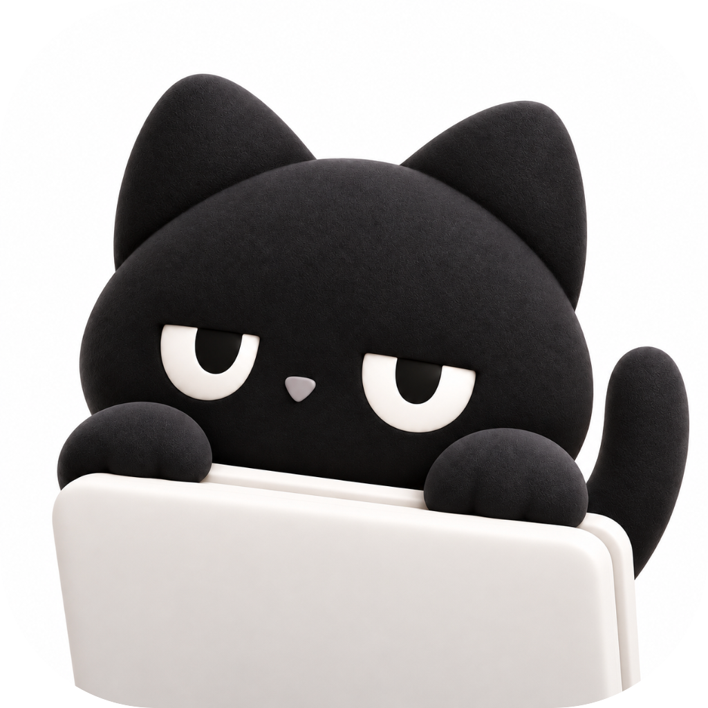
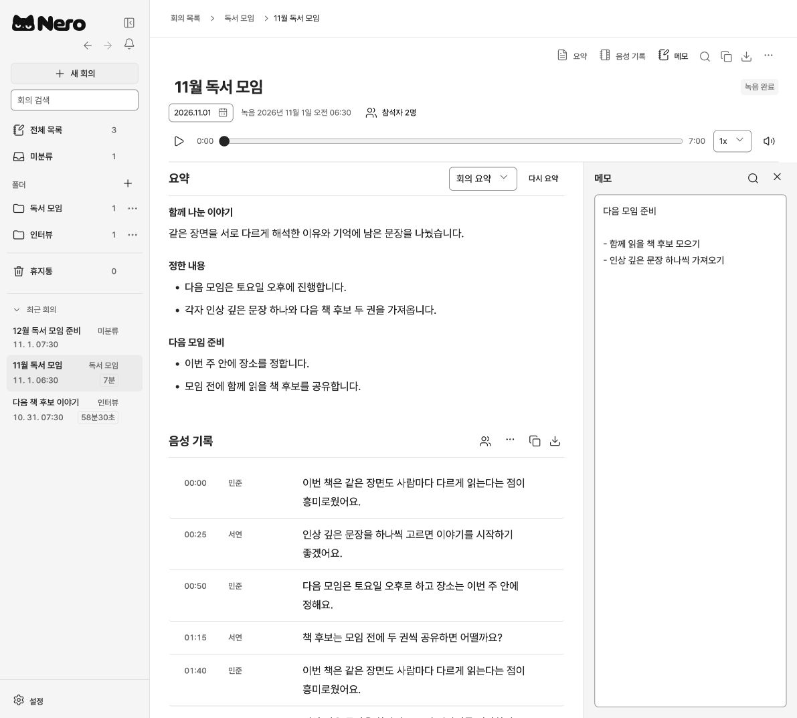
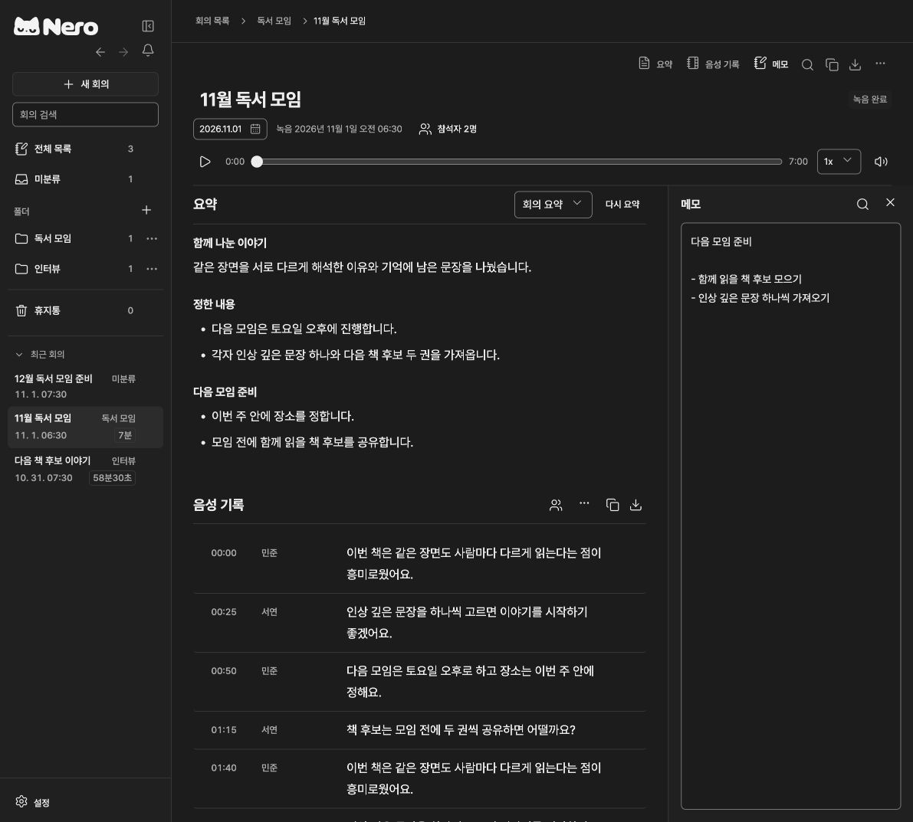

  

  <picture>
    <source media="(prefers-color-scheme: dark)" srcset="apps/desktop/brand/logo/nero-logo-dark.svg">
    
  </picture>

<strong>회의는 기록하고, 정리는 Nero에게.</strong>

내 컴퓨터에서 녹음하고, 글로 읽고, 회의록으로 정리하는 데스크톱 앱입니다.

  <a href="https://github.com/ChoSeongmin1128/Nero/releases/latest">다운로드</a> /
  <a href="#처음-시작하기">처음 시작하기</a> /
  <a href="docs/README.md">사용 안내</a> /
  <a href="https://github.com/ChoSeongmin1128/Nero/issues">문제 제보</a>

## 회의가 끝난 뒤에도 맥락이 남도록

요약과 음성 기록을 한 화면에서 읽고, 필요한 부분은 시간을 눌러 다시 들으세요. 옆에 메모를 열어 함께 정리할 수 있습니다.

| 라이트 | 다크 |
| :---: | :---: |
|  |  |

화면은 이전 버전의 앱 UI에 예시 데이터를 표시한 모습이며, 현재 화면과 일부 다를 수 있습니다. 이미지를 누르면 크게 볼 수 있습니다.

## Nero로 할 수 있는 일

| 기능 | 이렇게 사용하세요 |
| --- | --- |
| 녹음과 재생 | 마이크로 녹음하고 일시 정지/재개하세요. 저장한 음성 기록에서 시간을 눌러 해당 부분을 다시 들을 수 있습니다. |
| 음성 인식과 화자 구분 | 컴퓨터에서 음성을 글로 바꾸고, 필요하면 화자 구분을 켜세요. 인식한 내용과 화자 이름을 직접 고칠 수 있습니다. |
| 앱 안의 AI 대화 | 오른쪽 AI 대화에서 Claude나 ChatGPT에 질문하세요. 회의와 Notion 자료를 첨부하고 완성된 답변을 회의 요약이나 메모로 저장할 수 있습니다. |
| 회의 요약 | AI 대화 또는 연결한 외부 AI 도구로 회의록을 정리하세요. Nero의 로컬 모델 자동 요약은 품질 개선 중으로 일시 제공하지 않습니다. |
| 회의와 메모 정리 | 회의를 폴더에 모으고 제목, 날짜, 참석자와 메모를 함께 관리하세요. 사람과 그룹을 저장해 참석자를 빠르게 추가할 수 있습니다. |
| 음성 파일 가져오기 | WAV, M4A, MP3, AAC, AIFF, CAF, FLAC, Ogg 파일로 회의를 기록하세요. [지원 인코딩](docs/audio-import.md)은 파일 형식에 따라 다릅니다. |
| 캘린더와 참석자 | Google Calendar 일정의 초대자를 불러오고, 별도 동의 후 사용 가능한 Google Meet 참석 기록을 연결할 수 있습니다. |
| 외부 AI 도구 연결 | Claude나 ChatGPT에서 Nero의 회의를 찾고 활용하세요. 다른 도구에는 연결 프롬프트를 사용할 수 있습니다. |
| 라이트/다크 | 설정에서 원하는 테마를 선택하세요. |

## 다운로드

최신 설치 파일과 버전별 안내는 [GitHub Releases](https://github.com/ChoSeongmin1128/Nero/releases/latest)에서 확인하세요.

| 운영체제 | 설치 파일 | 지원 범위 |
| --- | --- | --- |
| macOS | `.dmg` | Apple Silicon, macOS 26 이상 |
| Windows | `-setup.exe` | x64, Windows 11에서 실행 확인 |

Intel Mac과 Linux용 설치 파일은 제공하지 않습니다.

## 처음 시작하기

1. 운영체제에 맞는 설치 파일로 Nero를 설치하고 실행하세요. macOS에서는 Nero를 응용 프로그램 폴더로 옮깁니다.
2. 앱의 안내에 따라 음성 인식 방식을 선택하세요. macOS 26에서는 시스템 기본 전사도 선택할 수 있습니다. 다운로드가 필요한 모델은 인터넷 연결과 여유 저장 공간이 필요합니다.
3. **새 회의**에서 녹음을 시작하거나 **음성 가져오기**로 기존 파일을 선택하세요. 녹음할 때는 마이크 접근을 허용합니다.
4. 녹음이 끝나면 음성 기록을 확인하고 화자 이름이나 본문을 수정하세요. 녹음 중 보이는 초안은 처리 완료 후의 저장 결과와 다를 수 있습니다.
5. 앱 안에서 질문하려면 오른쪽 AI 대화에서 Claude 또는 ChatGPT 구독 계정을 연결하세요. Claude는 공식 Claude Code 로그인을 사용하고 ChatGPT는 구독 계정으로 로그인합니다. 외부 AI 도구에서 Nero를 사용하려면 **설정 > 연동**에서 별도로 연결하세요.

macOS의 음성 인식은 **MOSS (기본)**, 명시적으로 선택하는 **Qwen3-ASR 한국어 (실험적)**, **macOS 기본 전사**를 제공합니다. 기존 선택은 유지하며 Windows의 선택지는 해당 릴리스 안내를 따릅니다. 모델별 처리 방식과 준비 방법은 [첫 실행과 연결](docs/setup-and-integrations.md)을 확인하세요.

## 내 회의는 어디에 저장되나요?

녹음, 메모, 음성 기록과 요약은 이 컴퓨터에 저장됩니다. 기본 음성 인식을 위해 회의 내용을 외부 AI 서버로 보내지 않습니다. MOSS와 Qwen은 모델을 준비한 뒤 로컬에서 전사합니다.

모델 다운로드, 앱 업데이트와 선택적인 외부 서비스 연결에는 인터넷이 필요합니다. AI 대화나 외부 AI 도구를 사용하면 선택하거나 요청한 회의 내용이 해당 서비스에 전달될 수 있습니다. 사용 중인 서비스의 데이터 처리 설정도 함께 확인하세요. Nero는 컴퓨터 사이의 회의 자동 동기화를 제공하지 않습니다.

## 알아두면 좋은 점

- 현재 녹음은 선택한 마이크의 입력을 사용합니다. 온라인 회의의 시스템 오디오를 별도로 수집하지 않습니다.
- 인식 속도와 모델 메모리 사용량은 기기와 녹음 길이에 따라 달라집니다. 모든 기기에서 실시간 처리를 보장하지 않습니다.
- 음성 기록, 화자 구분과 요약에는 오류가 있을 수 있습니다. 중요한 이름, 결정과 숫자는 원음과 대조하세요. 참석자 목록만으로 목소리의 주인을 자동 확정하지 않습니다.
- 기존 회의를 앱 실행이나 모델 변경만으로 자동 재처리하지 않습니다. 다시 처리할 회의는 직접 선택하세요.
- 새 업데이트는 자동으로 확인하고 다운로드합니다. 준비되면 사이드바 하단의 **업데이트**를 눌러 다시 시작하세요. 녹음과 처리 중에는 설치하지 않습니다.

## 도움이 필요하신가요?

[사용 안내](docs/README.md)에서 설치, 연결과 문제 해결 방법을 확인하세요. 오류나 개선 의견은 [Issues](https://github.com/ChoSeongmin1128/Nero/issues)에 남겨 주세요. 운영체제, 앱 버전과 재현 순서를 적어 주시면 확인에 도움이 됩니다. 녹음 원본이나 민감한 회의 내용은 공개 이슈에 첨부하지 마세요.

[개인정보처리방침](https://choseongmin1128.github.io/Nero/privacy.html)에서 데이터 처리와 외부 연결 범위를 확인할 수 있습니다.

소스에서 실행하거나 기여하려면 [개발 안내](apps/desktop/README.md), [개발/운영 환경 분리](docs/development.md), [전사 모델 선택](docs/speech-model-selection.md)을 확인하세요. 연구용 후보의 비교 방법은 [로컬 모델 평가](scripts/model-evaluation/README.md)에 있습니다. 평가 후보가 앱의 지원 모델로 자동 추가되지는 않습니다.

Nero 소스 코드는 [MIT License](LICENSE)로 제공합니다. 포함된 외부 구성 요소와 모델의 이용 조건은 [서드파티 고지](THIRD_PARTY_NOTICES.md)를 따릅니다.
